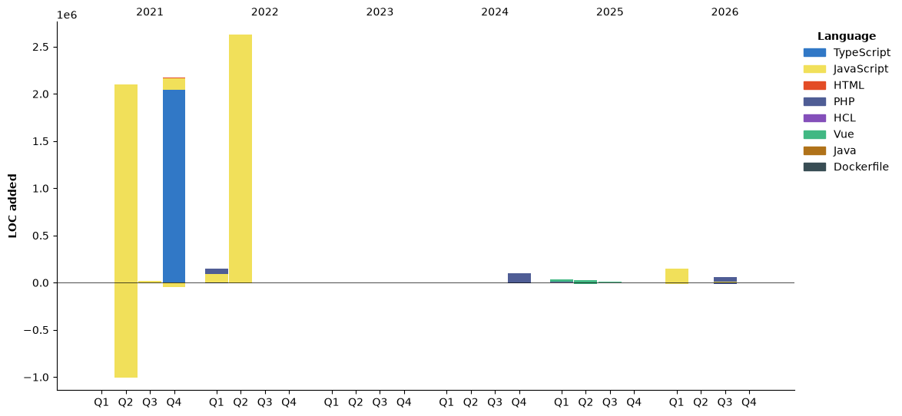

 
<!--START_SECTION:waka-->


**🐱 My GitHub Data** 

> 📦 425.8 kB Used in GitHub's Storage 
 > 
> 🏆 99 Contributions in the Year 2026
 > 
> 💼 Opted to Hire
 > 
> 📜 29 Public Repositories 
 > 
> 🔑 25 Private Repositories 
 > 
**I'm an Early 🐤** 

```text
🌞 Morning                395 commits         ██████░░░░░░░░░░░░░░░░░░░   22.47 % 
🌆 Daytime                574 commits         ████████░░░░░░░░░░░░░░░░░   32.65 % 
🌃 Evening                749 commits         ███████████░░░░░░░░░░░░░░   42.61 % 
🌙 Night                  40 commits          █░░░░░░░░░░░░░░░░░░░░░░░░   02.28 % 
```
📅 **I'm Most Productive on Monday** 

```text
Monday                   527 commits         ███████░░░░░░░░░░░░░░░░░░   29.98 % 
Tuesday                  284 commits         ████░░░░░░░░░░░░░░░░░░░░░   16.15 % 
Wednesday                268 commits         ████░░░░░░░░░░░░░░░░░░░░░   15.24 % 
Thursday                 190 commits         ███░░░░░░░░░░░░░░░░░░░░░░   10.81 % 
Friday                   248 commits         ████░░░░░░░░░░░░░░░░░░░░░   14.11 % 
Saturday                 136 commits         ██░░░░░░░░░░░░░░░░░░░░░░░   07.74 % 
Sunday                   105 commits         █░░░░░░░░░░░░░░░░░░░░░░░░   05.97 % 
```


📊 **This Week I Spent My Time On** 

```text
🕑︎ Time Zone: America/Sao_Paulo

💬 Programming Languages: 
Other                    4 mins              ████████████████████░░░░░   78.87 % 
XML                      1 min               █████░░░░░░░░░░░░░░░░░░░░   21.13 % 

🔥 Editors: 
Copilot CLI              4 mins              ████████████████████░░░░░   81.63 % 
VS Code                  1 min               █████░░░░░░░░░░░░░░░░░░░░   18.37 % 

🐱‍💻 Projects: 
b98e57ff-12eb-4381-8bc6-04 mins              ████████████████████░░░░░   78.87 % 
Unknown Project          1 min               █████░░░░░░░░░░░░░░░░░░░░   21.13 % 

💻 Operating System: 
Windows                  5 mins              █████████████████████████   100.00 % 
```

🤖 **AI Coding This Week** 

```text
⏱ AI Coding Time: 5 mins (100.0%)

✍️ 0 lines written by AI, 0 lines written by hand (0% AI-written)

🔤 0 Input Tokens, 0 Output Tokens

💵 $0.00 Estimated AI Cost This Week

🧠 1 AI Sessions, 2 AI Prompts

🔎 AI Coding Insights:
🧑‍💻 Mostly Hands-On — 0% of written lines came from AI
📝 Concise Prompter — average 80 characters per prompt
🔁 Iterative Prompter — average 2 prompts per session
🚀 High AI Trust — 0% of changed lines were hand-edited
```

**I Mostly Code in JavaScript** 

```text
JavaScript               16 repos            ████████░░░░░░░░░░░░░░░░░   33.33 % 
PHP                      15 repos            ████████░░░░░░░░░░░░░░░░░   31.25 % 
Vue                      6 repos             ███░░░░░░░░░░░░░░░░░░░░░░   12.50 % 
HTML                     4 repos             ██░░░░░░░░░░░░░░░░░░░░░░░   08.33 % 
CSS                      1 repo              █░░░░░░░░░░░░░░░░░░░░░░░░   02.08 % 
```


**Timeline**




 Last Updated on 01/11/2026 08:58:25 UTC
<!--END_SECTION:waka-->

## Github Stats  
<div align="center"></div>  

<br/>  

<br/>  

<div align="center">

</div>  
  
